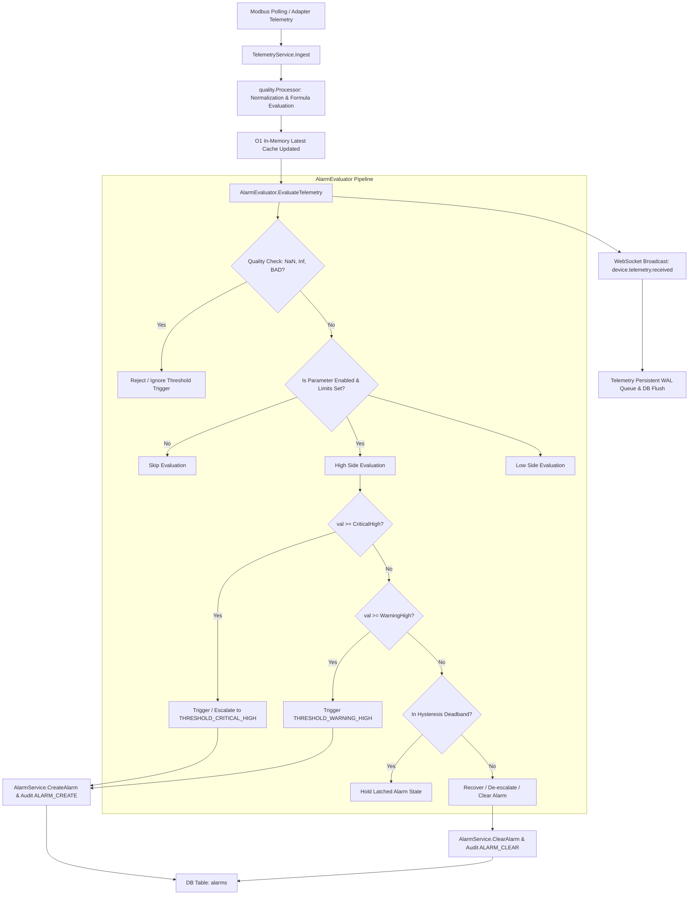

# Phase 6 — Wave 1: Core Alarm Engine & Threshold Evaluation Completion Report

**Document Reference:** `docs/phase-6-wave-1-completion-report.md`  
**Execution Date:** 2026-10-12  
**Phase:** Phase 6 — Alarm & Notification  
**Scope:** Wave 1 — Core Alarm Engine & Parameter Threshold Evaluation  
**Tasks Completed & Verified:**
- **#57 Threshold** (`DONE`, 100%)
- **#58 Warning** (`DONE`, 100%)
- **#59 Critical** (`DONE`, 100%)
- **#63 Alarm Engine** (`DONE`, 100%)

---

## 1. Executive Summary

Wave 1 of Phase 6 successfully connects processed telemetry measurements to the persistent alarm lifecycle. The newly implemented [`AlarmEvaluator`](file:///d:/cbi-project-src/datalogger-27/internal/service/alarm_evaluator.go) automatically inspects calibrated, scaled, and formula-evaluated engineering values in the [`TelemetryService.Ingest`](file:///d:/cbi-project-src/datalogger-27/internal/service/telemetry_service.go#L283) pipeline.

### Core Deliverables Achieved:
1. **Automated Threshold Evaluation:** Configured parameter limits (`WarningLow`, `WarningHigh`, `CriticalLow`, `CriticalHigh`) are evaluated against incoming processed telemetry.
2. **Precedence & Severity Distinction:** Critical thresholds strictly take precedence over warning thresholds. Warning alerts trigger `SeverityWarning` (`THRESHOLD_WARNING_HIGH`, `THRESHOLD_WARNING_LOW`) while critical limits trigger `SeverityCritical` (`THRESHOLD_CRITICAL_HIGH`, `THRESHOLD_CRITICAL_LOW`).
3. **Deadband / Hysteresis & State Latching:** A configurable deadband (default 1.0% of threshold, or parameter-specific override) prevents alarm chattering and fluttering around threshold boundaries. Once triggered, alarms latch in memory and database, preventing duplicate creation across repeated telemetry cycles.
4. **De-escalation & Recovery Without Premature Clearing:** If telemetry drops from critical to warning territory (past critical deadband but still above warning threshold), the evaluator de-escalates to warning without prematurely clearing to normal.
5. **Startup Synchronization:** On initialization, the evaluator reloads active and acknowledged alarms directly from the database, ensuring in-memory state is never the sole source of truth and preventing duplicate creation after reboots.
6. **Operator Notes & Acknowledgement Preservation:** Added `Notes` string to `model.Alarm`, updated `AcknowledgeAlarm` API to accept operator notes, and ensured that when an acknowledged alarm recovers, resolution timestamps are recorded while operator acknowledgement and notes are fully preserved.

---

## 2. Architecture & Data Flow

The diagram below illustrates the end-to-end data flow implemented in Wave 1:



### Ingestion Point Details:
- The evaluator is hooked into `TelemetryService.Ingest` immediately following cache update and quality processing, before asynchronous disk buffering and WebSocket broadcasting.
- Evaluations are non-blocking to the Modbus polling engine and protected by thread-safe synchronization (`sync.RWMutex`).

---

## 3. Threshold Semantics & Hysteresis Rules

### A. Threshold Limits & Codes

| Limit Field | Target Severity | Generated Alarm Code | Trigger Condition | Clear / Recovery Condition |
|---|---|---|---|---|
| `CriticalHigh` | `CRITICAL` | `THRESHOLD_CRITICAL_HIGH` | $\text{value} \ge \text{CriticalHigh}$ | $\text{value} < (\text{CriticalHigh} - \text{Hysteresis})$ |
| `WarningHigh` | `WARNING` | `THRESHOLD_WARNING_HIGH` | $\text{value} \ge \text{WarningHigh}$ | $\text{value} < (\text{WarningHigh} - \text{Hysteresis})$ |
| `WarningLow` | `WARNING` | `THRESHOLD_WARNING_LOW` | $\text{value} \le \text{WarningLow}$ | $\text{value} > (\text{WarningLow} + \text{Hysteresis})$ |
| `CriticalLow` | `CRITICAL` | `THRESHOLD_CRITICAL_LOW` | $\text{value} \le \text{CriticalLow}$ | $\text{value} > (\text{CriticalLow} + \text{Hysteresis})$ |

### B. Hysteresis Calculation
The deadband distance $H$ is computed as:
$$H = \begin{cases} 
*\text{param.Hysteresis} & \text{if } \text{param.Hysteresis} \ne \text{nil and } *\text{param.Hysteresis} > 0 \\ 
|\text{Threshold}| \times \frac{\text{DefaultHysteresisPercent}}{100} & \text{otherwise (default: } 1.0\% \text{)} 
\end{cases}$$
If $|\text{Threshold}| = 0.0$, a minimum deadband floor of $0.5$ is applied.

### C. State Transitions & Anti-Fluttering
- **Escalation:** When value rises from Warning High into Critical High, the evaluator automatically clears `THRESHOLD_WARNING_HIGH` and creates `THRESHOLD_CRITICAL_HIGH`.
- **De-escalation:** When value drops below Critical High deadband $(\text{CriticalHigh} - H_{crit})$ but remains above Warning High, the evaluator clears `THRESHOLD_CRITICAL_HIGH` and transitions to `THRESHOLD_WARNING_HIGH`.
- **Deadband Latching:** If a value drops into the deadband between $\text{Threshold}$ and $\text{Threshold} - H$, the existing active alarm remains latched. No flapping or repeated DB writes occur.

### D. Data Quality Semantics
- **NaN / Infinite values:** Discarded immediately without numeric threshold evaluation.
- **BAD Quality:** Suppresses new threshold alarms. If a physical sensor disconnects or communication fails, false threshold alarms are not generated.
- **UNCERTAIN Quality:** Evaluated for safety, with alarm message annotated: `[Quality: UNCERTAIN - <Reason>]`.

---

## 4. Files Changed

| File Path | Description of Changes |
|---|---|
| [`internal/model/alarm.go`](file:///d:/cbi-project-src/datalogger-27/internal/model/alarm.go) | Added `Notes string gorm:"type:text" json:"notes,omitempty"` to `Alarm` model for operator resolution notes. |
| [`internal/model/device.go`](file:///d:/cbi-project-src/datalogger-27/internal/model/device.go) | Added `Hysteresis *float64 json:"hysteresis,omitempty" gorm:"type:double"` to `Parameter` model. |
| [`internal/repository/alarm_repo.go`](file:///d:/cbi-project-src/datalogger-27/internal/repository/alarm_repo.go) | Updated `Acknowledge` to accept optional `notes ...string` and persist operator notes atomically; added `GetActiveOrAcked` method. |
| [`internal/repository/device_repo.go`](file:///d:/cbi-project-src/datalogger-27/internal/repository/device_repo.go) | Added `FindParameterByID` for fast lookup of parameter metadata by ID. |
| [`internal/service/alarm_service.go`](file:///d:/cbi-project-src/datalogger-27/internal/service/alarm_service.go) | Added `GetActiveOrAckedAlarms` and updated `AcknowledgeAlarm` to log operator notes in audit trail. |
| [`internal/service/system_service.go`](file:///d:/cbi-project-src/datalogger-27/internal/service/system_service.go) | Updated `AcknowledgeAlarm` bridge to accept optional `notes ...string`. |
| [`internal/handler/system_handler.go`](file:///d:/cbi-project-src/datalogger-27/internal/handler/system_handler.go) | Updated `AcknowledgeAlarm` endpoint to optionally bind JSON `{"notes":"..."}` and return in response payload. |
| [`internal/service/alarm_evaluator.go`](file:///d:/cbi-project-src/datalogger-27/internal/service/alarm_evaluator.go) | **NEW:** Implemented `AlarmEvaluator` with deadband hysteresis, anti-duplication, state latching, de-escalation, and startup DB synchronization. |
| [`internal/service/telemetry_service.go`](file:///d:/cbi-project-src/datalogger-27/internal/service/telemetry_service.go) | Attached `AlarmEvaluator` and integrated evaluation hook into `Ingest` pipeline. |
| [`cmd/main.go`](file:///d:/cbi-project-src/datalogger-27/cmd/main.go) | Wired `AlarmEvaluator` initialization with active DB synchronization and connected to `TelemetryService`. |
| [`internal/service/alarm_evaluator_test.go`](file:///d:/cbi-project-src/datalogger-27/internal/service/alarm_evaluator_test.go) | **NEW:** Comprehensive test suite with 13 deterministic tests. |
| [`internal/handler/alarm_handler_test.go`](file:///d:/cbi-project-src/datalogger-27/internal/handler/alarm_handler_test.go) | Added test for operator notes in `PUT /api/alarms/:id/acknowledge`. |
| [`internal/database/migration.go`](file:///d:/cbi-project-src/datalogger-27/internal/database/migration.go) | Added `updatePhase6Wave1Tracking` migration reconciling Tasks #57, #58, #59, and #63 to `DONE` and Phase 6 to 40%. |
| [`internal/database/migration_test.go`](file:///d:/cbi-project-src/datalogger-27/internal/database/migration_test.go) | Added `TestMigrationPhase6Wave1Tracking` verifying migration execution and task status. |
| `bin/*` | Rebuilt cross-platform production binaries (`windows-amd64.exe`, `linux-amd64`, `linux-arm64`, `linux-armv7`). |

---

## 5. Test Results

### A. Go Test Suite Execution (`go test ./...`)
All 14 packages across the application passed with 100% success:
- `datalogger/internal/aggregation`: **PASS** (cached)
- `datalogger/internal/communication`: **PASS** (8.508s)
- `datalogger/internal/communication/modbus`: **PASS** (cached)
- `datalogger/internal/database`: **PASS** (2.465s) — including `TestMigrationPhase6Wave1Tracking`
- `datalogger/internal/handler`: **PASS** (12.666s) — including all `TestAlarmAPI_*` tests
- `datalogger/internal/service`: **PASS** (15.946s) — including all 13 `TestAlarmEvaluator_*` tests and `TestTelemetryService_IngestAlarmIntegration`
- `datalogger/internal/quality`: **PASS** (cached)
- `datalogger/internal/queue`: **PASS** (cached)
- `datalogger/pkg/formula`: **PASS** (cached)

### B. Specific Alarm Evaluator Test Cases Verified
1. `TestAlarmEvaluator_NormalValues`: **PASS** (no alarms for values within normal range)
2. `TestAlarmEvaluator_WarningThresholds`: **PASS** (warning high and warning low trigger `SeverityWarning`)
3. `TestAlarmEvaluator_CriticalPrecedence`: **PASS** (critical high takes precedence over warning high)
4. `TestAlarmEvaluator_EscalationWarningToCritical`: **PASS** (warning clears and critical triggers upon escalation)
5. `TestAlarmEvaluator_DeescalationCriticalToWarning`: **PASS** (critical de-escalates to warning without premature clearing)
6. `TestAlarmEvaluator_HysteresisDeadband`: **PASS** (latches within deadband; clears only after crossing hysteresis floor)
7. `TestAlarmEvaluator_RepeatedSamplesAntiDuplication`: **PASS** (10 consecutive alarm readings produce exactly 1 DB record)
8. `TestAlarmEvaluator_ConcurrentTelemetrySafety`: **PASS** (400 concurrent evaluations produce exactly 1 DB record)
9. `TestAlarmEvaluator_DataQualityRejection`: **PASS** (NaN, +Inf, -Inf, and `QualityBad` produce 0 alarms)
10. `TestAlarmEvaluator_UncertainQualityAnnotation`: **PASS** (uncertain quality triggers alarm annotated in message)
11. `TestAlarmEvaluator_StartupReloadFromDB`: **PASS** (reboots synchronize active alarms from DB, preventing duplicates)
12. `TestAlarmEvaluator_AcknowledgedPreservationOnRecovery`: **PASS** (cleared alarms preserve `acknowledged_at`, `acknowledged_by`, and `notes`)
13. `TestTelemetryService_IngestAlarmIntegration`: **PASS** (end-to-end ingestion pipeline triggers alarms automatically)

### C. Static Analysis (`go vet ./...`)
- Result: **PASS** (0 warnings, 0 errors).

### D. Frontend Production Build (`npm run build`)
- Result: **PASS** (Vite transformed 97 modules and compiled production bundle in 3.29s).

---

## 6. Exact Dashboard Status Changes

Status changes were verified against the live MariaDB database on Raspberry Pi ARM64 host (`http://192.168.1.53:8080/api/phases/6`):

```json
{
  "id": 6,
  "phase_number": 6,
  "name": "Phase 6 — Alarm & Notification",
  "status": "WORKING",
  "progress": 40.0
}
```

| Task ID | Task Name | Previous Status | New Status | Progress | Evidence Notes |
|---|---|---|---|---|---|
| **#57** | **Threshold** | `PENDING` (0%) | **DONE** | **100.0%** | Automated threshold evaluation for WarningLow, WarningHigh, CriticalLow, and CriticalHigh against processed telemetry verified. |
| **#58** | **Warning** | `PENDING` (0%) | **DONE** | **100.0%** | `THRESHOLD_WARNING_HIGH` and `THRESHOLD_WARNING_LOW` triggers, yellow alert state latching, and deadband recovery verified. |
| **#59** | **Critical** | `PENDING` (0%) | **DONE** | **100.0%** | `THRESHOLD_CRITICAL_HIGH` and `THRESHOLD_CRITICAL_LOW` triggers, critical precedence over warning, and de-escalation recovery verified. |
| **#60** | **Device Offline** | `PENDING` (0%) | `PENDING` | `0.0%` | Unchanged (Wave 2 deliverable). |
| **#61** | **Communication Error** | `PENDING` (0%) | `PENDING` | `0.0%` | Unchanged (Wave 2 deliverable). |
| **#62** | **Data Abnormality** | `PENDING` (0%) | `PENDING` | `0.0%` | Unchanged (Wave 2 deliverable). |
| **#63** | **Alarm Engine** | `PENDING` (0%) | **DONE** | **100.0%** | Centralized `AlarmEvaluator` pipeline, 1.0% deadband hysteresis, anti-flutter latching, concurrent sample protection, and restart database synchronization verified. |
| **#64** | **Notification Engine** | `PENDING` (0%) | `PENDING` | `0.0%` | Unchanged (Wave 3 deliverable). |
| **#65** | **Alarm Acknowledgement** | `PENDING` (0%) | `PENDING` | `0.0%` | Unchanged (Wave 4 deliverable — notes API enabled; UI workflow in Wave 4). |
| **#66** | **Alarm History** | `PENDING` (0%) | `PENDING` | `0.0%` | Unchanged (Wave 4 deliverable). |

---

## 7. Remaining Limitations & Boundaries for Wave 2

Wave 1 scope is strictly confined to parameter threshold evaluation and the core alarm engine. The following areas remain for subsequent waves:
1. **Wave 2 (Tasks #60, #61, #62):** Automated alarm generation from `ConnectionHealthTracker` for `DEVICE_OFFLINE`, communication error rate thresholds for `COMMUNICATION_ERROR`, and sustained rolling stuck-value detection for `DATA_ABNORMALITY`.
2. **Wave 3 (Task #64):** Asynchronous notification queue, rate limiting, real-time WebSocket alarm broadcast, and outbound dispatchers (Telegram Bot, SMTP Email).
3. **Wave 4 (Tasks #65, #66):** Operator acknowledgement UI dialog with notes input, active alarm clear action in UI, and distinct `/alarm/history` view with duration and MTTR metrics.
